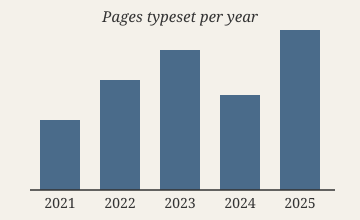
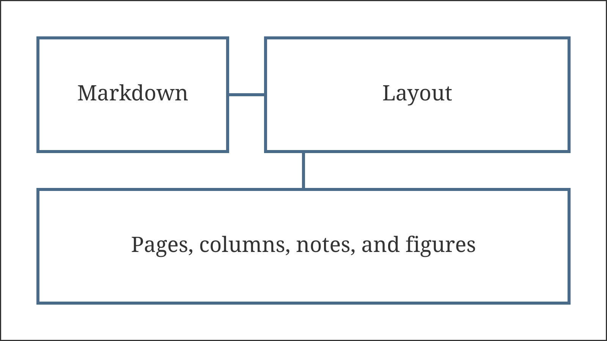

# Notes beside the text

A margin note sits in the column beside the prose, on the outer side of the page.[^outer] It has no number and no mark in the text: its first line stands on the baseline of the line that refers to it, so the reader finds it at a glance. Margin notes suit short asides, sources, and cross-references that would interrupt a sentence.

[^outer]: {-} The outer side is on the right of odd pages and on the left of even pages, unless the theme keeps margins the same on every page.

A note is written like a footnote whose definition starts with `{-}`. Footnotes keep their numbers and their place at the foot of the page,[^foot] unless the theme turns them into sidenotes. Then they move to the same column as the margin notes, with their numbers, and the foot of the page stays empty.

[^foot]: An ordinary footnote. With sidenotes, this note stands in the margin next to its number in the text.

Two notes referenced close together would overlap. The second moves down until it clears the first,[^first] and a third one follows below.[^second] The text does not move for them.[^third]

[^first]: {-} The first of three notes referenced on neighbouring lines.

[^second]: {-} The second note starts below the first, a little lower than its own line.

[^third]: {-} The third note stacks below the other two.

## Notes at the foot of the page

Notes near the bottom of a page may not fit below their lines. Then the notes of the page move up together, each still in order, until the last ends at the bottom of the text area. A page never ends with notes that cannot fit: the search for page breaks counts the height of every note on a page, and a note too tall for any page is an error naming its line.

Typesetting has always been a negotiation between the content and the page. A paragraph can bend: its lines can break in many places, its spaces can stretch, and a page can end between any two of its lines. A note in the margin bends too, since it may move up, but a figure is a rigid box that the page has to make room for.

The paragraphs of this section run toward the bottom of the page so that the notes referenced in them have to move up. Each is short and refers to the subject of its sentence, as a reader's annotation would.[^bottom-one] Compositors call such notes marginalia; medieval manuscripts are full of them.[^bottom-two]

[^bottom-one]: {-} A note referenced near the foot of the page, with a second line so that it needs some room.

[^bottom-two]: {-} The last note of the page. It ends at the bottom of the text area, and the notes above it move up to make room.

# Placed figures

{#fig:chart placement=top}

A figure or table may go to the top or bottom of a page instead of where it stands. @fig:chart is placed at the top: it goes to the top of the page where its anchor falls if it fits there, otherwise to the top of the next page. The text after it keeps filling the current page. A reference to a placed figure names the page where it lands, so @fig:chart is on [@fig:chart, page], and @tbl:sizes on [@tbl:sizes, page].

| Paper | Width  | Height |
|:------|-------:|-------:|
| A5    | 148 mm | 210 mm |
| A4    | 210 mm | 297 mm |
| Letter | 216 mm | 279 mm |

: Common paper sizes, placed at the bottom of the page. {#tbl:sizes placement=bottom}

A table placed at the bottom sits above the footnotes. Placed blocks keep their order among themselves: a figure never overtakes another placed figure, and a top block and a bottom block on the same page come in the order of the text.

The space between a placed block and the text is the space the theme puts around figures. A placed table must fit on one page, since it does not continue. Placed figures shrink to the page height together with their caption, as figures in the text do.

{#fig:plan placement=top}

The drawing above is anchored near the end of a page, where the top of that page is already taken by text that comes before the anchor and the chart. If it does not fit there, it moves to the top of the next page, and this paragraph stays where it is.

Text keeps flowing around the placed blocks. This paragraph and the next fill the rest of the page so that the search can decide where the drawing goes. A page that holds a placed block has less room for text, and the search weighs that like any other content.

Each placed block has an anchor, the place in the text where it is written. A block may go to the page of its anchor or a later page, never an earlier one, and it waits at most until the next explicit page break, chapter, or the end of the document.

A block that is still waiting when the section ends is set before the page break, on a page of its own if no text is left to share one with. Druck prefers that to moving text back to make room, since the text before a placed block should read on without a gap.

Figures that stay where they stand do not wait for placed ones. A theme that places every figure at the top keeps their numbers in order on paper as well, since placed blocks never pass each other.

The search for page breaks treats a placed block like the footnotes of a page: its height takes room from the text, so the break before it moves up. Margin notes do not take room from the text, since they stand beside it, but they must fit the height of the page together.

# Placed blocks in columns

A full-width block inside a column section may hold a placed figure. It goes to the top or bottom of the page across both columns, and the columns below it stay balanced.

::: columns
Two columns hold the short notes of a field report. A margin note referenced in either column stands in the outer margin, beside its line.[^column] The notes of both columns share that margin, ordered from top to bottom.

[^column]: {-} A note from the first column.

The figure in the full-width block below is placed at the bottom of the page. Its anchor stands between these paragraphs, but it does not split the columns: they run on as one section and are balanced above it.

::: full-width
{#fig:landscape placement=bottom}
:::

The second column continues the report. Observations are short, and each paragraph holds one of them. A note from the second column also goes to the outer margin.[^second-column]

[^second-column]: {-} A note from the second column, beside its line.

The last paragraph of the section ends the report. Columns are balanced at the end of a section, so the text below starts under the taller column.
:::

The text after the columns runs across the prose width again. The landscape at the bottom of the page is @fig:landscape, on [@fig:landscape, page].
